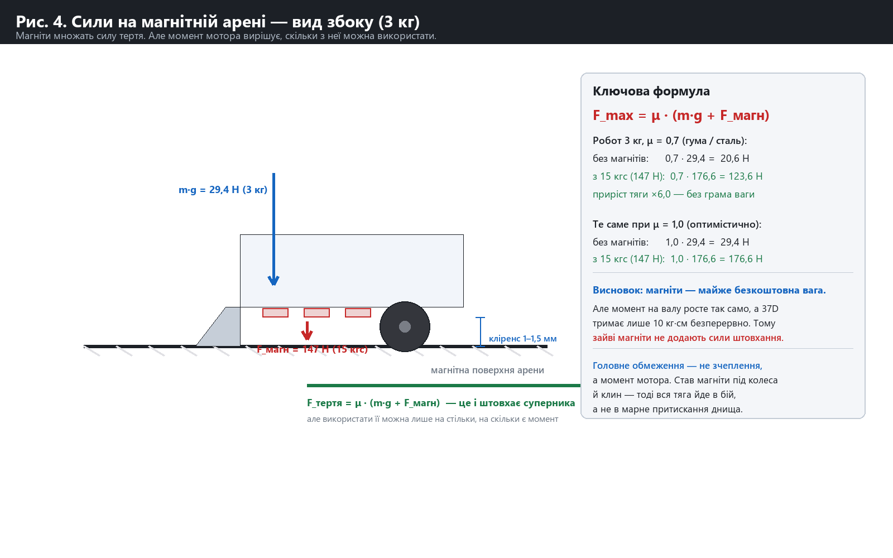
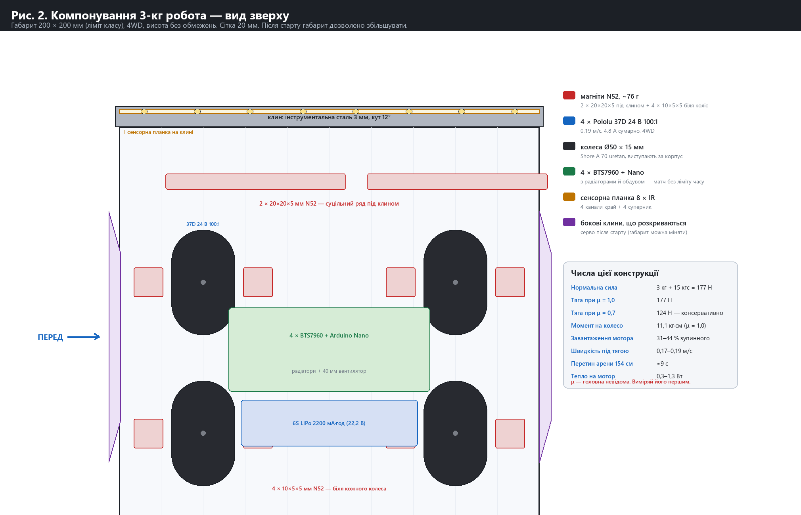
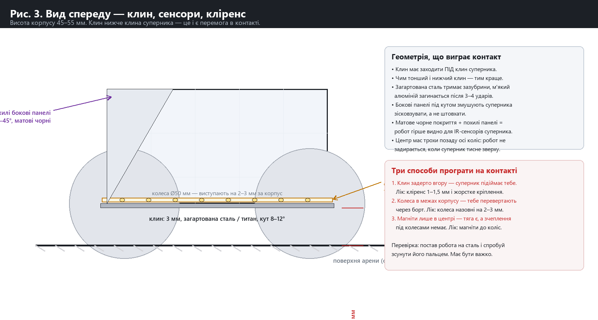
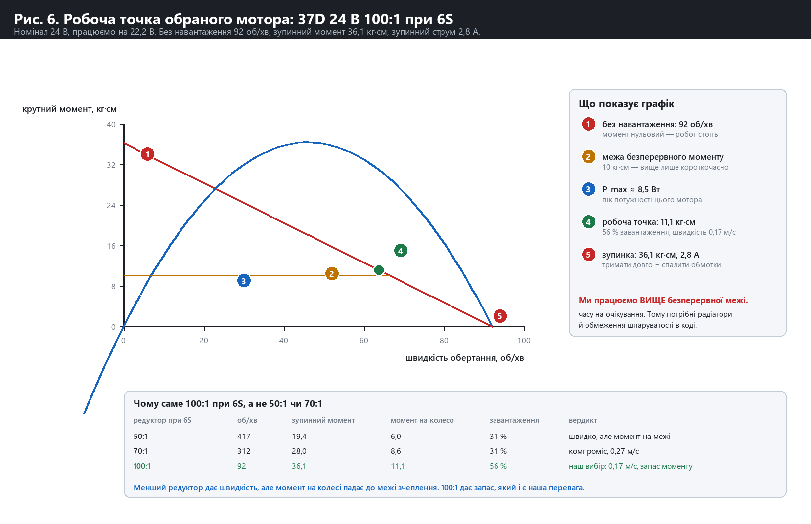
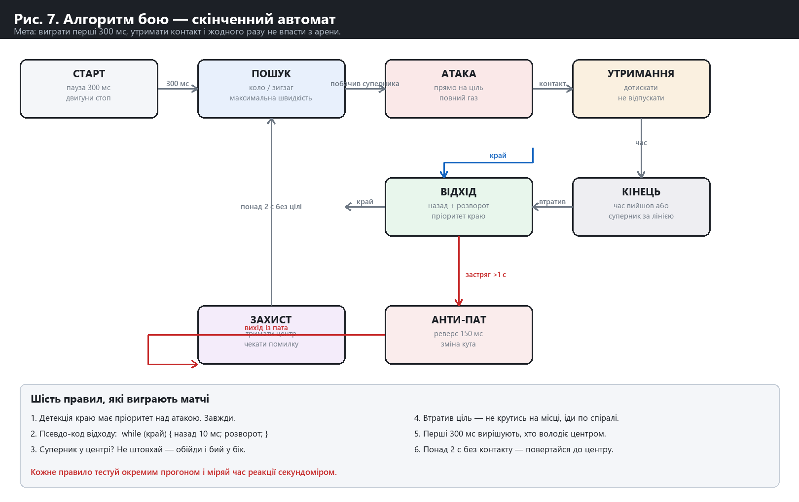
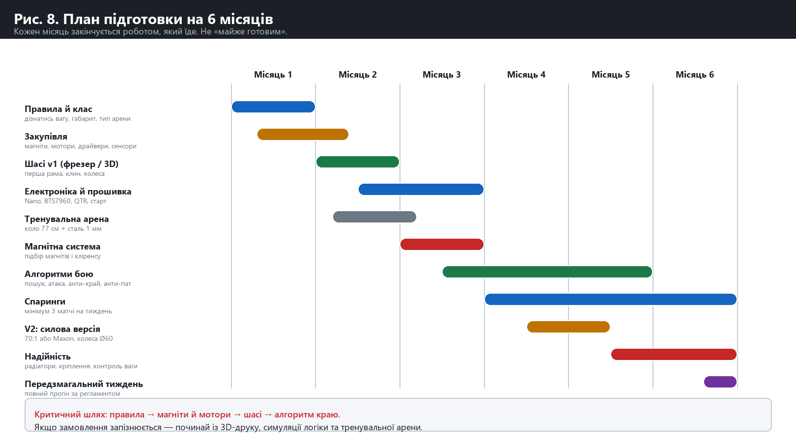

# Робосумо: плейбук команди

**Клас:** 3 кг (Mega Sumo) · **Арена:** сталь, 154 см · **Магніти:** дозволені
**Формат:** матч до вибиття (без ліміту часу) · **Бюджет:** $500 на деталі
**Габарит:** 200 × 200 мм на старті; **після старту габарит можна збільшувати**

Правила підтверджені організаторами. Це змінює три речі проти початкового плану:

1. **Клас 3 кг, а не 1 кг** — мотори стають головною статтею бюджету.
2. **Матч без ліміту часу** — тепловий режим важливіший за швидкість.
3. **Габарит можна збільшувати після старту** — це відкриває механізми, яких у стандартному сумо не буває.

---

## 0. Головний висновок розрахунків

**Магніти не роблять вашого робота сильнішим. Вони роблять його важчим для суперника.**

Це найважливіше, що треба зрозуміти до закупівлі деталей. Сила, з якою робот штовхає, обмежена **не зчепленням, а моментом мотора**. Магніти лише підвищують поріг, за яким колеса починають прослизати.

Для нашої конструкції (3 кг, 15 кгс магнітів):

| | μ = 0,7 (реалістично) | μ = 1,0 (оптимістично) |
|---|---|---|
| Нормальна сила | 176,6 Н | 176,6 Н |
| **Доступне зчеплення** | **123,6 Н** | **176,6 Н** |
| **Реальна сила штовхання** | **48 Н** (обмежена моторами) | **48 Н** |

Тобто **48 Н** — це все, чим ми штовхаємо, незалежно від кількості магнітів. Але щоб **нас** зсунути, супернику потрібно подолати 123,6 Н тертя. Різниця між 48 і 124 Н — це і є наша перевага.

**Практичний висновок:** більше магнітів понад ~15 кгс не додає сили штовхання — воно лише додає ваги й гріє мотори. Оптимум — рівно стільки притиску, щоб мотори використовували своє зчеплення повністю, і не більше.

---

## 1. Конструкція

| Параметр | Значення | Чому саме так |
|---|---|---|
| Габарит на старті | 200 × 200 мм, висота без ліміту | ліміт класу |
| Габарит у бою | розкладається до ~260 мм по фронту | **правила дозволяють** — див. §3 |
| Вага | 2 900–2 980 г | запас на ремонт на місці |
| Привід | **4WD**, 4 × Pololu 37D **24 В 100:1** | момент розподіляється на 4 колеса |
| Живлення | **6S LiPo 22,2 В** (1,25× від номіналу 24 В) | швидкість і момент масштабуються з напругою |
| Колеса | Ø50 × 15 мм, **Shore A 70 uretan** | м'який силікон деформується під притиском і псує зазор |
| Кліренс під клином | **1,0–1,5 мм** | при 2 мм втрачається 38 % притискної сили |
| Магніти | **~76 г N52**: 2 × 20×20×5 під клином + 4 × 10×5×5 біля коліс | тяга потрібна там, де контакт |
| Клин | інструментальна сталь 3 мм, кут 12° | м'який алюміній гнеться за кілька ударів |
| Бокові клини | серво, розкладаються після старту | див. §3 |
| Корпус | алюміній 7075, 3 мм, **матовий чорний** | див. §4.3 |

### Робоча точка

| Параметр | Значення |
|---|---|
| Момент на колесо (μ = 1,0) | 11,1 кг·см |
| Завантаження мотора | 31–44 % зупинного моменту |
| Струм | 0,94–1,20 А на мотор, **3,7–4,8 А сумарно** |
| Швидкість під тягою | 0,17–0,19 м/с |
| Перетин арени 154 см | ≈9 с |
| Тепло на мотор | 0,3–1,3 Вт |

---

## 2. Тепловий режим — головний ризик формату «до вибиття»

Pololu прямо обмежує 37D: «**the recommended upper limit for continuously applied loads is 10 kg-cm**», а ми працюємо на 11,1 кг·см. Тобто **ми свідомо виходимо за безперервну межу** — і саме тому формат «до вибиття» небезпечний: у звичайному сумо матч триває 3 хвилини, а тут — доки хтось не вилетить.

**Три обов'язкові заходи:**

1. **Радіатори на всі 4 BTS7960** і 40-мм вентилятор з обдувом. Не опція.
2. **Обмеження шпаруватості в прошивці:** якщо струм перевищує 1,5 А на мотор довше 3 секунд — скидати до 60 % ШІМ. Робот втрачає трохи сили, але не спалює обмотки.
3. **Запасний комплект моторів на місці.** Найчастіша відмова в цьому класі.

Розрахунок показує, що при 50 % шпаруватості середня потужність розсіювання — 0,25 Вт на мотор, що цілком безпечно. Проблема лише в безперервному контакті, коли робот стоїть у заклиненому стані.

> ⚠️ **μ — головна невідома.** Коефіцієнт тертя гуми по сталі з поліуретановим покриттям **ніде не виміряний**. Я використав 0,7 і 1,0 як межі, і це масштабує всі числа тяги. Виміряй його першим: поклади робота на сталеву пластину і повільно нахиляй, доки не почне ковзати. `μ = tan θ`.

---

## 3. Габарит можна змінювати після старту — що це дає

Це найнезвичайніше правило, і воно відкриває три механізми. Усі — з підтверджених джерел.

### 3.1 Бокові клини, що розкриваються

Найцінніше застосування. На старті робот — 200 мм, у бою — ~260 мм по фронту. Це дає:

- **Ширший фронт клина** — супернику важче обійти і важче зайти в бік.
- **Захист кутів.** Кути — найслабше місце будь-якого робота, і саме туди цілять. Розкриті бокові клини закривають їх.
- **Механічний важіль.** Боковий клин працює як напрямна: суперник, що тисне в бік, зісковзує, а не штовхає.

Механізм: серво SG90 + важіль, розкладання за 100–150 мс після стартового сигналу. Серво живити від окремого 5 В (UBEC), не від Nano.

### 3.2 «Прапорець» — трюк, що виграв турнір

**NEMO 03** (1-ше місце, Robotic Day Prague 2018, minisumo) використовує **серво, що викидає прапорець на тонкому дроті** на старті. Експлуатується те, що IR-сенсори суперника реагують на **відбивну здатність, а не на робота**: суперник на повній швидкості атакує обʼєкт нульової маси й вилітає з арени.

Правила це не забороняють. Ризик: суддя може визнати це неспортивним. **Рекомендація: тримай механізм у резерві як «план Б» для плей-оф, а не як основну тактику.**

### 3.3 Клин, що виїжджає вперед

Після старту можна висунути клин на 30–40 мм уперед. Це дає нижчу точку контакту й раніший дотик. Простіше за бокові клини — почни з цього.

---

## 4. Сенсори й алгоритм

### 4.1 Розкладка

8 IR-каналів на планці клина, висота 1,5–2 мм:

- **канали 1, 2, 7, 8** — край арени: біла підлога → чорна лінія
- **канали 3, 4, 5, 6** — суперник

**Пастка:** суперник може бути білим або дзеркальним — IR його не побачить. Тому дублюй детекцію **струмом моторів** через INA226: різкий стрибок струму = контакт, навіть коли IR «сліпий».

### 4.2 Програмна межа — головний важіль

З притиском зчеплення дозволяє прискорення понад **100 м/с²**. Один `delay(5)` коштує більше, ніж весь розгін.

1. **Жодного `delay()` і `Serial.print()` у циклі матчу.**
2. Планувальник на таймері, крок **≤1 мс**.
3. **Перші 150 мс — 100 % ШІМ, читати лише сенсори краю.**

### 4.3 Матовий чорний — це тактика

**Виміряний результат:** матові чорні обʼєкти стають невидимими для IR-сенсорів типу GP2Y0A41SK0F **на 30–40 мм пізніше**, ніж білі чи жовті. Суперник виявляє тебе на 3–4 см пізніше — саме там, де вирішується контакт.

### 4.4 Формат «до вибиття» змінює тактику

Без ліміту часу:

- **Не можна виграти за очками.** Немає тайбрейку «ближче до центру» — є лише вибитий суперник.
- **Терпіння виграє.** Захисна стійка з притиснутим клином і очікуванням помилки стає життєздатною, бо час не тисне.
- **Але пасивність карається.** Якщо робот не рухається понад ~10 с, суддя зазвичай віддає очко супернику. Тому «захист» = тримати центр і реагувати, а не стояти.
- **Тепло — ресурс.** Кожна секунда штовхання гріє мотори. Плануй бій як серію коротких зіткнень, а не безперервний тиск.

### 4.5 Шість правил

1. **Детекція краю має абсолютний пріоритет.** Робот, що вилетів, не виграє ніколи.
2. **Відхід короткими кроками:** `while (край) { назад 10 мс; розворот; }` — довгий відхід викидає з арени з іншого боку.
3. **Суперник у центрі?** Не штовхай у лоб — обійди і бий у бік.
4. **Втратив ціль** — іди по спіралі, не крутись на місці.
5. **Перші 300 мс** вирішують, хто володіє центром.
6. **Понад 2 с без контакту** — повертайся до центру.

---

## 5. Кошторис — у межах $500

Жорсткий ліміт — $500 на деталі. Курс: 1 USD = 44,68 ₴ (НБУ, 01.10.2026).

| Позиція | Конкретно | Ціна |
|---|---|---|
| Мотори ×4 | Pololu 37D 24 В 100:1 | $160.00 |
| Драйвери ×4 | BTS7960 43 А (prom.ua, 186,60 ₴) | $16.72 |
| Контролер | Arduino Nano v3 clone (244 ₴) | $5.46 |
| Живлення | LM2596 5 В + конденсатори 1000 мкФ | $4.00 |
| Акумулятор | 6S LiPo 2200 мА·год 30C (22,2 В) | $30.00 |
| Зарядка | LiPo balance charger | $28.00 |
| Сенсори | QTR-8A + 2 × INA226 | $25.00 |
| Магніти | 2 × 20×20×5 + 4 × 10×5×5, N52 (~76 г) | $34.00 |
| Шасі | алюміній 7075 3 мм, лазерний різ (батч) | $16.00 |
| Клин | інструментальна сталь 200×30×3 + загартування | $18.00 |
| Колеса | 4 × Ø50 uretan + маточини | $44.00 |
| Механіка | підшипники, вали, кріплення, дроти, XT60, запобіжник | $46.00 |
| Розкладний механізм | SG90 + тяги + UBEC | $6.00 |
| Охолодження | радіатори + 40 мм вентилятор | $10.00 |
| **Разом** | | **$443.18** |
| **Залишок** | на запчастини | **$56.82** |

**Запас іде на:** запасний мотор ($40) — найчастіша відмова, плюс запобіжники й дріт. Другий акумулятор і запасні колеса — з наступних надходжень, якщо будуть.

**Правила закупівлі:**
1. **Локально:** магніти, драйвери, Arduino, LiPo, різання. BTS7960 на prom.ua відрізняється від AliExpress на ~$1.30 — не варто чекати місяць.
2. **Імпорт:** мотори (найдовша доставка — замов першими).
3. **Батч різання:** мінімальне замовлення 700 ₴ ≈ $16. Замов плити одразу на 2–3 роботи — ціна за робота обвалюється.

---

## 6. Чого НЕ робити

Ці поради загальнопоширені, але в нашій конфігурації вони шкодять:

| Не роби | Чому |
|---|---|
| Ставити 200+ магнітів, як японські роботи | Їхні мотори — Maxon на 400 Вт. Наш 37D — 10 Вт. Зайвий притиск лише гріє мотори й не додає сили штовхання |
| Брати редуктор 70:1 «на момент» | 0,39 м/с — робот не встигне доїхати. Потрібен баланс, а не максимум моменту |
| Ставити м'який силікон | Деформується під притиском, псує зазор, втрачає силу |
| Використовувати L298N або DRV8871 | 2–3,6 А проти 5,5 А зупинного струму. Просадка напруги вбиває момент |
| Overvolting вище 6S | Тепло ∝ I², а матч без ліміту часу. 6S — межа здорового глузду |
| Сподіватись на магніти як на зброю | Вони дають **захист**, а не **силу**. Силу дає момент мотора |

---

## 7. План на 6 місяців

| Місяць | Що зробити | Критерій готовності |
|---|---|---|
| **1** | **Виміряти μ** (нахил пластини). Замовити мотори — найдовша доставка | Є число μ, а не здогад |
| **2** | Шасі v1, тренувальна арена (коло 154 см, сталь 1 мм на фанері) | Робот їздить, не розсипається |
| **3** | Електроніка, прошивка, детекція краю | **20 прогонів підряд без вильоту** |
| **4** | Магнітна система: масив, кліренс, вимірювання сили вагами | Робот «як скеля» — не зсунути пальцем |
| **5** | Тепловий режим: радіатори, обдув, ліміт ШІМ. Спаринги | 10 матчів поспіль без перегріву |
| **6** | Розкладний механізм, надійність, прогони за регламентом | 10 матчів без відмов |

**Критичний шлях:** μ → мотори → шасі → алгоритм краю → тепло.

**Головний тест 3-го місяця:** дай роботу працювати 5 хвилин і порахуй вильоти. Якщо хоч один — алгоритм краю не готовий, і жодні магніти це не компенсують.

---

## 8. Перші три дії

1. **Цими вихідними:** виміряти μ. Сталева пластина, нахил, `μ = tan θ`. Це замінює всі оцінки в цьому документі твоїм власним числом.
2. **Цього тижня:** замовити 4 мотори (найдовша доставка) і купити локально драйвери + Arduino + магніти.
3. **Паралельно:** зібрати тренувальну арену — коло 154 см зі сталі 1 мм на фанері (~$25, один вечір).

---

## Додаток A. Ключові числа

| Величина | Значення | Джерело |
|---|---|---|
| Вага | 3 000 г | правила класу |
| Габарит на старті | 200 × 200 мм | правила класу |
| Арена | сталь, 154 см, висота 5 см | підтверджено організаторами |
| Притиск магнітів | ~147 Н (15 кгс) | розрахунок, k = 8–10 Н/г N52 |
| Нормальна сила | 176,6 Н | 3 кг + 15 кгс |
| Момент на колесо | 11,1 кг·см | μ = 1,0 |
| Струм | 4,8 А сумарно | 37D 24 В 100:1 |
| Швидкість | 0,17–0,19 м/с | 6S, 50 мм колеса |
| Тяга | 123,6 Н (μ = 0,7) | F = μ·N |

## Додаток B. Джерела

**Регламенти:**
- [All Japan Robot-Sumo Tournament, Reglamento V4.2](https://www.fsi.co.jp/sumo/robot/en/Rules/Regulation/AJRST%20Reglamento%20Oficial%20V4.2_Espanol.pdf) — арена Art. 3, заборони Art. 7.6
- [Baltic Robot Sumo — Game Rules](http://robotika.lv/read_write/file/BRS%20Robot-Sumo_Game_Rules.pdf)
- [RoboGames — Unified Sumo Robot Rules](https://robogames.net/rules/all-sumo.php) — Art. 6.7 про магніти
- [RobotChallenge — RoboSumo Rules 2025](http://www.robotchallenge.org.cn/doc/en/RC-Sumo.pdf)

**Магніти й інженерія:**
- [Łapińska et al., IJMERR 9(5) 2020](https://ijmerr.com/uploadfile/2020/0417/20200417064856590.pdf) — виміряні сили, Halbach
- [Dziubek et al., IJMERR 10(6) 2021](https://www.ijmerr.com/uploadfile/2021/0624/20210624100758933.pdf) — гібридна система, розподіл магнітів
- [ThundeRatz «Stonehenge»](https://thunderatz.org/projects/robots/stonehenge) — реальний 3-кг робот
- [Pololu 37Dx54L 24 В](https://www.pololu.com/product/4745) — дані виробника

**Турнір:**
- [RAU.ua — RoboSumo 2025–26](https://rau.ua/news/mayibutnye-ukrayinskogo-tech/)
- [Світ КПІ — RoboSumo 2026](https://svit.kpi.ua/2026/03/19/)
- [U-PROX Robo Sumo Cup 2024](https://u-prox.systems/u-prox-robo-sumo-cup-2024-v-kiyevi-yak-cze-bulo/)

**Первинне джерело тактики:** «Blackbook of Sumo Robots — Tactics, Tips & Suggestions», JSumo, Firat Faris Dede, 41 с.

## Додаток C. Дослідницькі звіти

- [10_rules_findings.md](research/10_rules_findings.md) — регламенти з дослівними цитатами
- [11_engineering_findings.md](research/11_engineering_findings.md) — інженерія, 90 посилань
- [12_bom_findings.md](research/12_bom_findings.md) — кошторис із цінами
- [build/design_scan.py](build/design_scan.py) · [build/final_config.py](build/final_config.py) — розрахунки, які можна перезапустити зі своїм μ
